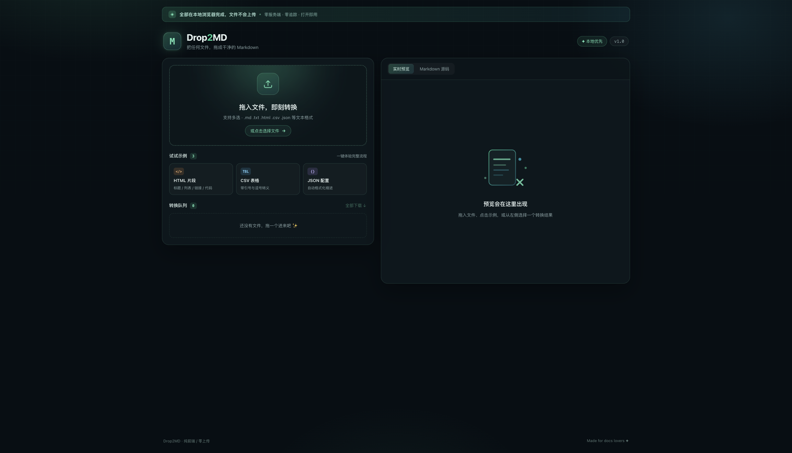

<div align="center">

[English](README.md) | [中文](README-zh.md)

📄

# Drop2MD

**拖入任意文件，即刻得到干净的 Markdown —— 100% 在本地浏览器完成。**

[](https://github.com/webxiongda/drop2md/stargazers)
[](LICENSE)
[](https://github.com/webxiongda/drop2md/pulls)
[](https://react.dev/)
[](https://www.typescriptlang.org/)

</div>

<div align="center">
  
</div>

## 为什么选择 Drop2MD？

把文档转换成 Markdown，通常意味着要把它发送到一个服务器上。在线转换工具会上传你的文件，把它们放进一个你无法掌控的队列，再返回一段你无法完整核验的标记文本。对于任何敏感内容 —— 个人笔记、合同、内部文档 —— 这种交换都很难让人放心。

Drop2MD 走了相反的路。它受 [microsoft/markitdown](https://github.com/microsoft/markitdown) 势头的影响，把「万物转 Markdown」这件事搬进了浏览器本身。每个文件都通过 File API 读取并在本地解析；没有任何上传，不涉及后端，也没有统计脚本窥探你拖进来的内容。即使关掉网络，它依然可用。

结果是一个专注于常见任务的工作台：批量拖入文件，看着干净的 Markdown 出现在实时预览里，然后复制或下载即可。它是一个可以部署到任何地方的静态站点，可以嵌进门户，也可以完全离线运行。

## 特性

| 特性 | 说明 |
| --- | --- |
| 拖拽即转 | 支持一次拖入多个文件或点击多选，悬停有上浮反馈，拖入动画清晰。 |
| 隐私优先 | 所有解析都在浏览器内通过 File API 与 DOMParser 完成。零网络请求、无后端、无遥测。 |
| 结构化 HTML 提取 | DOMParser 将标题、段落、嵌套列表、链接、代码块、引用、分割线与表格提取为 Markdown。 |
| 引号安全的 CSV / TSV | 状态机解析器正确处理引号包裹、转义引号（`""`）、字段内逗号与分隔符，输出干净的 Markdown 表格。 |
| JSON 美化 | `.json`、`.jsonl`、`.ndjson` 会自动缩进格式化，并包进 `json` 代码块。 |
| 实时且安全的预览 | 零依赖渲染器支持标题、强调、代码、链接、列表与表格 —— 通过 HTML 转义与链接协议白名单阻止 XSS。 |
| 批量队列与清单 | 逐个显示文件名、大小、状态与目标 `.md` 名；支持批量改名并导出可复制的下载清单。 |
| 复制或下载 | 复制单个结果、下载单个 `.md`，或一键下载整个队列。 |
| 历史与设置 | localStorage 最多保留 100 条结果；可选亮色/暗色预览主题、默认导出方式与历史策略。 |
| 开箱示例 | 一键加载 HTML、CSV、JSON 示例，走的是与真实文件完全相同的转换流程。 |

## 快速开始

```bash
git clone https://github.com/webxiongda/drop2md.git
cd drop2md
npm install && npm run dev
```

打开终端提示的本地地址即可使用。生产构建请先运行 `npm run build`，再运行 `npm run preview`。

## 页面

Drop2MD 使用 hash 路由；十个页面中的每一页都可以直接通过链接访问。

| Hash | 页面 | 作用 |
| --- | --- | --- |
| `#/convert` | 转换工作台 | 拖入文件，即刻得到干净的 Markdown。 |
| `#/queue` | 文件队列 | 管理已加入的全部文件与转换状态。 |
| `#/preview` | 预览中心 | 大屏预览与源码对照，支持全屏沉浸。 |
| `#/formats` | 格式指南 | 每种格式怎么转，输入与输出并排对照。 |
| `#/history` | 转换历史 | 随时重新加载本地保存的结果。 |
| `#/examples` | 示例库 | 一键加载真实样例，快速体验完整流程。 |
| `#/batch` | 批量操作 | 批量改名、查看汇总表格并导出下载清单。 |
| `#/guide` | 使用指南 | 四步上手，隐私永远优先。 |
| `#/about` | 关于与热点 | 缘起、社区热点、技术栈与许可证。 |
| `#/settings` | 设置 | 预览主题、默认导出与历史策略。 |

## 工作原理

程序先检查每个文件开头的字节以探测二进制内容（NUL 字节、控制字符比例、严格 UTF-8 校验），再由扩展名选择转换器。HTML 经由 DOMParser 做结构化提取；CSV / TSV 经由一个感知引号的状态机，转义竖线并保留字段内逗号；JSON 经由 `JSON.stringify` 包进代码块；其他文本文件则成为带语言提示的代码块。预览渲染器在生成任何标签之前，会对每个文本节点做转义，并用白名单校验链接协议，因此文件内容永远不可能变成可执行标记。队列、历史与设置保存在 localStorage 中，读取时对损坏数据做容错处理，并在存储不可用时优雅降级为内存态。

## 技术栈

- **React 18** —— 界面与状态管理。
- **TypeScript** —— 严格类型，`tsc` 零错误。
- **Vite 5** —— 构建工具与开发服务器。
- **浏览器 API** —— DOMParser、File API、localStorage。
- **零额外运行时依赖** —— 路由、渲染与转换全部自写；运行时只依赖 `react` 与 `react-dom`。

## 文档

- [English README (英文文档)](README.md)
- [贡献指南 (Contributing Guide)](CONTRIBUTING.md)
- [MIT 许可证 (License)](LICENSE)

## 贡献

欢迎贡献 —— 本项目刻意保持精简，因此聚焦的小改动也能带来实际价值。我们非常欢迎针对新增格式解析器、Markdown 渲染功能、补充示例与测试的 bug 报告与 PR。如果想找切入点，请查看带有 `good first issue` 标签的 issue；扩展 `src/converter.ts` 中的格式规则或 `src/markdown.ts` 中的渲染器都是不错的起点。提交 PR 前请先阅读[贡献指南](CONTRIBUTING.md)。

## 路线图

- [ ] 通过纯浏览器解析器支持更多格式（DOCX、PDF 文本、EPUB）
- [ ] 扩展 Markdown 渲染语法（任务列表、脚注、定义列表）
- [ ] 从设置中导出的 JSON 备份导入并恢复数据
- [ ] 为高级用户提供键盘快捷键与命令面板
- [ ] 中英文之外的界面国际化（i18n）

## 许可证

[MIT](LICENSE) © 2026 Drop2MD contributors
