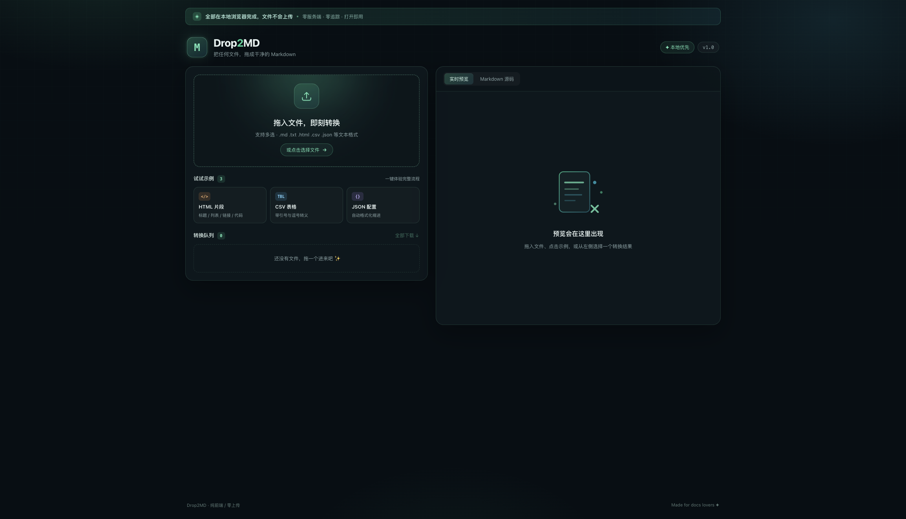

<div align="center">

[English](README.md) | [中文](README-zh.md)

📄

# Drop2MD

**Drag any file in, get clean Markdown out — 100% in your browser.**

[](https://github.com/webxiongda/drop2md/stargazers)
[](LICENSE)
[](https://github.com/webxiongda/drop2md/pulls)
[](https://react.dev/)
[](https://www.typescriptlang.org/)

</div>

<div align="center">
  
</div>

## Why Drop2MD?

Turning a document into Markdown usually means shipping it to a server. Online converters upload your files, hold them in a queue you do not control, and hand back markup you cannot fully verify. For anything sensitive — personal notes, contracts, internal docs — that trade-off is hard to justify.

Drop2MD takes the opposite route. Inspired by the momentum behind [microsoft/markitdown](https://github.com/microsoft/markitdown), it brings "anything to Markdown" into the browser itself. Every file is read with the File API and parsed locally; nothing is uploaded, no backend is involved, and no analytics watch what you drop in. Close the network tab and it still works.

The result is a focused workspace for a common job: drag a batch of files, watch clean Markdown appear in a live preview, then copy or download it. It is a static site you can host anywhere, embed in a portal, or run entirely offline.

## Features

| Feature | Description |
| --- | --- |
| Drag-and-drop conversion | Drop multiple files at once or click to multi-select, with hover feedback and a clear drop animation. |
| Privacy by default | All parsing happens in-browser via File API and DOMParser. Zero network requests, no backend, no telemetry. |
| Structured HTML extraction | DOMParser walks headings, paragraphs, nested lists, links, code blocks, blockquotes, rules, and tables into Markdown. |
| Quote-safe CSV / TSV | A state-machine parser handles quoted fields, escaped quotes (`""`), embedded commas, and delimiters, emitting clean Markdown tables. |
| JSON pretty-printing | `.json`, `.jsonl`, and `.ndjson` are formatted with indentation and wrapped in a fenced `json` block. |
| Live, safe preview | A dependency-free renderer covers headings, emphasis, code, links, lists, and tables — with HTML escaping and a link-protocol whitelist to block XSS. |
| Batch queue & manifest | Track name, size, status, and target `.md` name per file; rename in bulk and export a copyable download checklist. |
| Copy or download | Copy a single result, download one `.md`, or download the whole queue in one click. |
| History & settings | localStorage keeps up to 100 results; choose light/dark preview themes, default export, and history policy. |
| Ready-made samples | One-click HTML, CSV, and JSON examples run through the exact same conversion path as real files. |

## Quick Start

```bash
git clone https://github.com/webxiongda/drop2md.git
cd drop2md
npm install && npm run dev
```

Open the local URL printed in your terminal. For a production build, run `npm run build` followed by `npm run preview`.

## Pages

Drop2MD uses hash routing; each of its ten pages is a directly linkable view.

| Hash | Page | What it does |
| --- | --- | --- |
| `#/convert` | Conversion Workbench | Drop files and get clean Markdown instantly. |
| `#/queue` | File Queue | Manage every added file and its conversion status. |
| `#/preview` | Preview Center | Large preview with source comparison and immersive fullscreen. |
| `#/formats` | Format Guide | See how each format converts, with input and output side by side. |
| `#/history` | Conversion History | Revisit locally saved results and reload them any time. |
| `#/examples` | Examples Library | Load real samples in one click to experience the full flow. |
| `#/batch` | Batch Operations | Rename in bulk, review a summary table, and export a download manifest. |
| `#/guide` | User Guide | Four steps to get started, privacy always first. |
| `#/about` | About & Trends | The origin, community signals, tech stack, and license. |
| `#/settings` | Settings | Preview theme, default export, and history policy. |

## How it works

Each file's leading bytes are checked for binary content (NUL bytes, control-character ratio, strict UTF-8), and the extension selects a converter. HTML goes through DOMParser for structured extraction; CSV / TSV through a quote-aware state machine that escapes pipes and preserves embedded commas; JSON through `JSON.stringify` into a fenced block; other text files become fenced code blocks with a language hint. The preview renderer escapes every text node and validates link protocols against a whitelist before emitting any tag, so file content can never become executable markup. The queue, history, and settings live in localStorage with corruption-tolerant reads and a graceful in-memory fallback when storage is unavailable.

## Tech Stack

- **React 18** — UI and state management.
- **TypeScript** — strict types, `tsc` with zero errors.
- **Vite 5** — build tooling and dev server.
- **Browser APIs** — DOMParser, File API, localStorage.
- **Zero extra runtime dependencies** — routing, rendering, and conversion are all hand-written; only `react` and `react-dom` ship at runtime.

## Documentation

- [中文文档 (Chinese README)](README-zh.md)
- [Contributing Guide](CONTRIBUTING.md)
- [MIT License](LICENSE)

## Contributing

Contributions are welcome — this project is kept deliberately small, so focused changes have a real impact. Bug reports and pull requests for new format readers, Markdown renderer features, additional samples, and tests are all appreciated. If you are looking for a place to start, check the issues labeled `good first issue`; extending the format rules in `src/converter.ts` or the renderer in `src/markdown.ts` is a good entry point. Please read the [Contributing Guide](CONTRIBUTING.md) before opening a PR.

## Roadmap

- [ ] More format readers (DOCX, PDF text, EPUB) via pure-browser parsers
- [ ] Additional Markdown renderer syntax (task lists, footnotes, definition lists)
- [ ] Import and restore from the JSON backup exported in Settings
- [ ] Keyboard shortcuts and a command palette for power users
- [ ] Interface i18n beyond English and Chinese

## License

[MIT](LICENSE) © 2026 Drop2MD contributors
